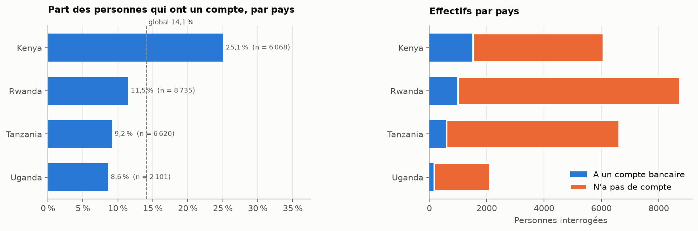
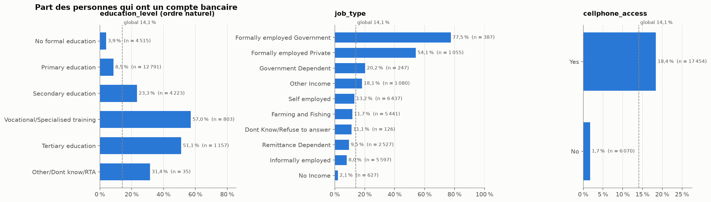
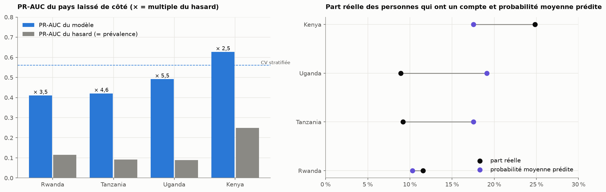
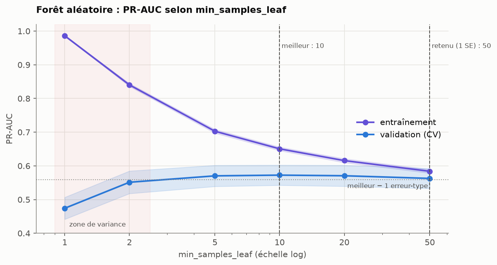
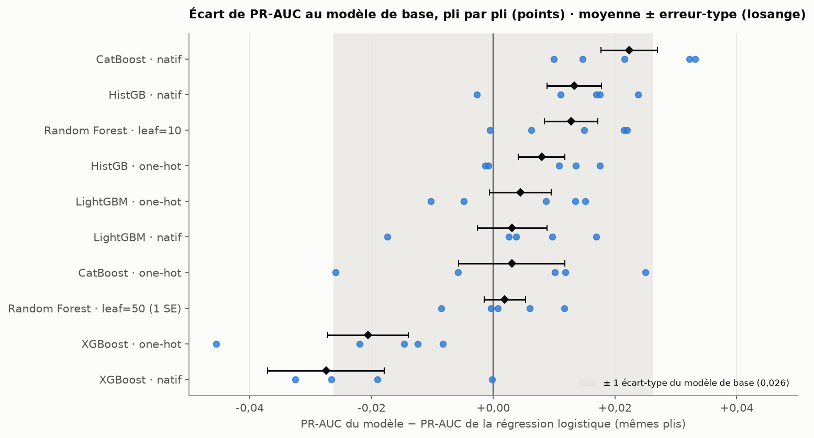

# Qui possède un compte bancaire ? Prédire l'inclusion financière en Afrique de l'Est

Cas pratique du **Module 5 · AIMS Sénégal** (Évaluation et optimisation des modèles de ML).
De la donnée brute à un modèle évalué honnêtement : pipeline sans fuite, validation croisée
stratifiée, méthodes d'ensemble, optimisation des hyperparamètres (Random Search, Optuna),
calibration, seuil selon les coûts et interprétation (permutation, SHAP).

> 🚧 **Projet en cours** : étapes 0 à 6 terminées. Les résultats des modèles et les limites seront
> ajoutés au fil des étapes ; la version finale du README sera rédigée à l'étape 12.

## Avancement

| Étape | Contenu | Notebook | État |
|---|---|---|---|
| 0 | Projet uv, dépôt GitHub | — | ✅ |
| 1 | Définir le problème : cadrage métier, métriques, seuil $t^*$ | `01_exploration` | ✅ |
| 2 | Explorer les données (Q2.1–Q2.7, 13 figures) | `01_exploration` | ✅ |
| 3 | Préparer les données, construire les variables, pipeline | `02_preparation_protocole` | ✅ |
| 4 | Protocole d'évaluation honnête (test sous scellé, CV stratifiée, CV par pays) | `02_preparation_protocole` | ✅ |
| 5 | Baselines et diagnostic biais–variance | `03_baselines_ensembles` | ✅ |
| 6 | Méthodes d'ensemble (Random Forest, XGBoost, LightGBM, CatBoost) | `03_baselines_ensembles` | ✅ |
| 7 | Optimisation des hyperparamètres (Random Search, Optuna) | `04_hyperparametres` | ⏳ |
| 8–9 | Calibration et seuil selon les coûts | `05_calibration_seuil` | — |
| 10–11 | Test final, interprétation (permutation, SHAP) | `06_test_final_interpretation` | — |
| 12 | Publication | — | — |

## Le problème

Chaque ligne est une **personne interrogée** par les enquêtes FinScope (2016–2018) ; la cible
`bank_account` vaut 1 si elle **a un compte bancaire**. Classification binaire **déséquilibrée** :
**14,08 %** des personnes ont un compte (3 312 sur 23 524).

Deux usages métier (hypothèses pédagogiques, fixées dans `config.py`) :

- **KaziPay** contacte les personnes qui ont un compte pour leur proposer un service de paiement
  mobile. Contacter une personne sans compte coûte **0,5 USD** (faux positif) ; oublier une
  personne qui a un compte fait perdre **5 USD** (faux négatif). Avec des probabilités calibrées,
  le seuil optimal est $t^* = C_{FP}/(C_{FP}+C_{FN}) = 1/11 \approx 0{,}091$.
- La **banque centrale** estime le nombre de personnes qui ont un compte dans chaque pays en
  additionnant les probabilités prédites : elles doivent être **calibrées**.

| Rôle | Choix |
|---|---|
| Métrique principale | **PR-AUC** (classe positive rare) |
| Métriques secondaires | **Brier** (banque centrale), **coût total** au seuil retenu (KaziPay) |
| Rapportées aussi | ROC-AUC, log-loss, précision, recall, accuracy, rapport de classification complet |
| Plancher | `DummyClassifier` (« toujours Non » : accuracy 85,9 %, recall 0) |
| **Modèle de base** | **Régression logistique**, que tout modèle plus complexe doit battre de plus d'un écart-type |

## Ce que l'exploration a montré



- **Fort écart entre pays** : 25,1 % au Kenya contre 8,6 % en Ouganda. Le pays est un facteur de
  confusion ; un modèle appliqué ailleurs devra être recalibré.
- **Trois hypothèses**, à confronter à l'interprétation du modèle (étape 11) :
  l'**éducation** (3,9 % sans éducation formelle → 57 % avec une formation professionnelle),
  l'**emploi formel** (77,5 % des salariés de l'État contre 2,1 % des personnes sans revenu) et
  le **téléphone** (96,9 % des personnes qui ont un compte en ont un).



- **Colonnes retirées** : `uniqueid` (identifiant, numérotation par pays) et `year` (entièrement
  déterminée par le pays).
- **Bruit irréductible** : 7,4 % des lignes appartiennent à des profils identiques aux étiquettes
  contradictoires ; tout modèle commet au moins 2,2 % d'erreurs.
- **Pièges de données suivis tout au long du projet** : deux modalités rares (*Dont know*,
  8 lignes, toutes au Kenya ; *Other/Dont know/RTA*, 35 lignes), un `job_type` codé différemment
  selon le pays, et 1 799 personnes déclarées *Spouse* mais *Single* en Tanzanie.
- **Équité** : 10,7 % des femmes ont un compte contre 19,0 % des hommes, et *Spouse* est à 98,6 %
  féminin (proxy du genre). Un audit d'équité est prévu à l'étape 11.

## La préparation des données

```python
from sklearn.linear_model import LogisticRegression
from financial_inclusion_africa.data import clean, load_raw
from financial_inclusion_africa.features import pipe

X, y = clean(load_raw())                               # retire uniqueid, year et la cible
logreg = pipe(LogisticRegression(max_iter=2000))       # AddFeatures → one-hot + standardisation → modèle
```

- **`AddFeatures`** (sans apprentissage) ajoute les variables du guide (`education_rank`,
  `is_head`, `formal_job`, `urban_phone`, `age_group`), un indicateur `education_unknown`, et deux
  variables métier : `phone_education` (interaction téléphone × éducation) et `lives_alone`.
- Les transformations qui **apprennent** (encodage, imputation, standardisation) sont dans le
  pipeline et ajustées dans chaque pli : pas de fuite.
- **Modalités rares et inconnues** : regroupées (`min_frequency=20`) ou traitées sans erreur ;
  *Other/Dont know/RTA* n'a pas de rang dans l'ordre de l'éducation (NaN, imputée dans le pli).
- **Encodage selon la famille de modèle** : `pipe(model, encoding=...)`

| `encoding` | Préparation | Modèles |
|---|---|---|
| `"onehot"` (défaut) | one-hot + imputation + standardisation (`scale=False` pour l'omettre) | régression logistique |
| `"ordinal"` | codes entiers, numériques intactes | Random Forest |
| `"native"` | dtype `category`, numériques intactes | XGBoost, LightGBM, HistGradientBoosting |
| `"native_str"` | texte, numériques intactes | CatBoost (`catboost_cat_features()`) |

## Le protocole d'évaluation

```python
from financial_inclusion_africa.data import load_split
from financial_inclusion_africa.evaluate import CV, evaluate_cv, format_summary

X_train, X_test, y_train, y_test = load_split()      # 80 / 20 stratifié ; X_test scellé jusqu'à l'étape 10
row, res = evaluate_cv(logreg, X_train, y_train)     # même objet CV (StratifiedKFold 5 plis) pour tous les modèles
```

- **Test sous scellé** : 18 819 lignes d'entraînement, 4 705 de test, même prévalence (14,08 % et 14,07 %).
- **Validation croisée** : un seul objet `CV`, pour comparer tous les modèles sur les mêmes plis
  (différences appariées). Métriques : PR-AUC, ROC-AUC, Brier, log-loss, accuracy, et précision,
  recall et coût par personne au seuil $t^*$.

| Validation croisée stratifiée (5 plis) | PR-AUC | ROC-AUC | Brier | Recall à $t^*$ | Coût / personne |
|---|---|---|---|---|---|
| Plancher (`DummyClassifier`) | 0,141 | 0,500 | 0,121 | 1,000 | 0,43 USD |
| **Modèle de base (régression logistique)** | **0,561 ± 0,026** | 0,849 ± 0,010 | 0,087 ± 0,003 | 0,852 ± 0,011 | 0,26 USD |

- **Un pays jamais vu** (`StratifiedGroupKFold` par pays) : la PR-AUC tombe à **0,487 ± 0,086**
  et surtout les probabilités sont mal calibrées (Ouganda : 19,1 % prédit pour 8,9 % réel). Un
  déploiement dans un autre pays (Sénégal) exigerait des données locales et une recalibration.



## Baselines et diagnostic biais–variance

| Validation croisée (5 plis) | PR-AUC | Entraînement | Diagnostic |
|---|---|---|---|
| Plancher | 0,141 | 0,141 | — |
| **Régression logistique** (modèle de base) | **0,561 ± 0,026** | 0,566 | **biais** : plafond ≈ 0,56 |
| Forêt aléatoire, réglages par défaut | 0,475 ± 0,034 | 0,986 | **variance** : mémorise le bruit |
| Forêt régularisée (`min_samples_leaf=10`) | 0,573 ± 0,031 | 0,651 | bon compromis : +0,013, inférieur à l'écart-type |

- Les variables du guide apportent +0,002 de PR-AUC (5 plis sur 5, mais 10 fois moins que
  l'écart-type) ; nos deux variables n'apportent rien.
- Plus de données avec les mêmes variables n'aiderait aucun des deux modèles (courbes
  d'apprentissage) ; la forêt a besoin de **régularisation**.



## Méthodes d'ensemble (réglages par défaut)

| Validation croisée (5 plis) | PR-AUC | Écart au modèle de base (plis gagnés) | Temps / pli |
|---|---|---|---|
| **CatBoost, catégories natives** | **0,583 ± 0,027** | +0,022 (5/5) | 22 s |
| HistGradientBoosting, natif | 0,574 ± 0,026 | +0,013 (4/5) | 0,4 s |
| Random Forest (`min_samples_leaf=10`) | 0,573 ± 0,031 | +0,013 (4/5) | 2,6 s |
| LightGBM (one-hot / natif) | 0,565 / 0,564 | +0,004 / +0,003 | 0,3 s |
| Régression logistique (modèle de base) | 0,561 ± 0,026 | — | 0,2 s |
| XGBoost (one-hot) | 0,540 ± 0,025 | −0,021 (0/5) | 1,0 s |

- **Pas de vainqueur net** : aucun écart ne dépasse l'écart-type (0,026), mais CatBoost natif
  devance le modèle de base dans les 5 plis.
- **Catégories natives** : décisives pour CatBoost (+0,019 sur sa version one-hot), sans effet net
  pour les autres boostings.
- **Surapprentissage par défaut** : fort pour XGBoost, modéré pour LightGBM.
- **Candidats pour l'étape 7** : CatBoost natif (performance) et LightGBM natif (rapidité, marge de
  réglage).



## Données

Compétition **Financial Inclusion in Africa** ([Zindi](https://zindi.africa)), issue des enquêtes
FinScope 2016–2018 au Kenya, au Rwanda, en Tanzanie et en Ouganda. Les données **ne sont pas
versionnées** : téléchargez-les depuis Zindi et placez-les dans `data/raw/` :

```
data/raw/inclusion-financiere-en-afrique.csv
data/raw/VariableDefinitions.csv
```

## Installation

Le projet utilise **Python 3.14** et [uv](https://docs.astral.sh/uv/) (qui installe Python
automatiquement si besoin).

```bash
git clone git@github.com:kmache/financial-inclusion-africa.git
cd financial-inclusion-africa
uv sync
```

| Commande | Usage |
|---|---|
| `uv run jupyter lab` | Ouvrir les notebooks avec l'environnement du projet |
| `uv run pytest` | Lancer les tests de `tests/` |
| `uv run ruff check --fix src tests` | Vérifier et corriger le style du code |
| `uv sync` | Recréer exactement l'environnement à partir de `uv.lock` |

## Structure

```
financial-inclusion-africa/
├── data/raw/                      # données brutes (non versionnées)
├── data/processed/                # fichiers intermédiaires (non versionnés)
├── notebooks/                     # 01 → 06, exécutables de haut en bas
├── src/financial_inclusion_africa/
│   ├── config.py                  # chemins, graine, coûts métier
│   ├── data.py                    # chargement, séparation X / y, test sous scellé (load_split)
│   ├── eda.py                     # exploration : taux par modalité, V de Cramér, doublons, modalités rares
│   ├── features.py                # AddFeatures, préprocesseurs, pipe(model, features, encoding)
│   ├── evaluate.py                # métriques, coût, seuil t*, protocole de CV (CV, SCORING, cv_summary)
│   └── viz.py                     # style et graphiques (palettes validées daltonisme)
├── reports/figures/               # figures exportées par les notebooks
└── tests/                         # 42 tests (pytest)
```

## Règles

`random_state = 42` partout · le test reste scellé jusqu'à l'étape 10 · même objet `cv` pour tous
les modèles · toujours la moyenne ± l'écart-type · une étape, un commit.
