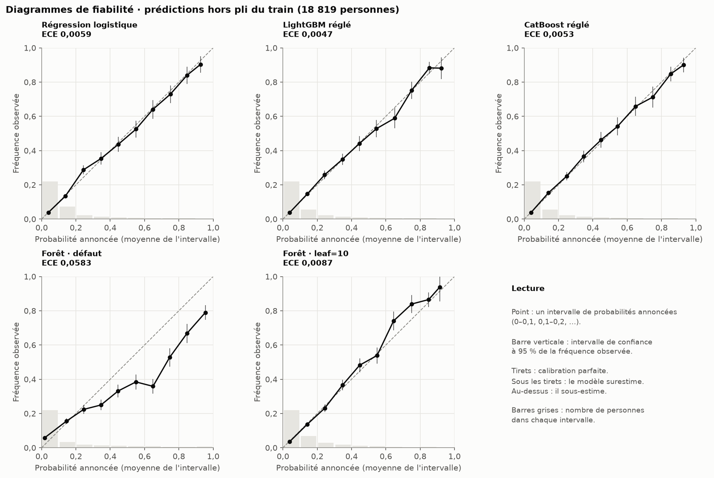
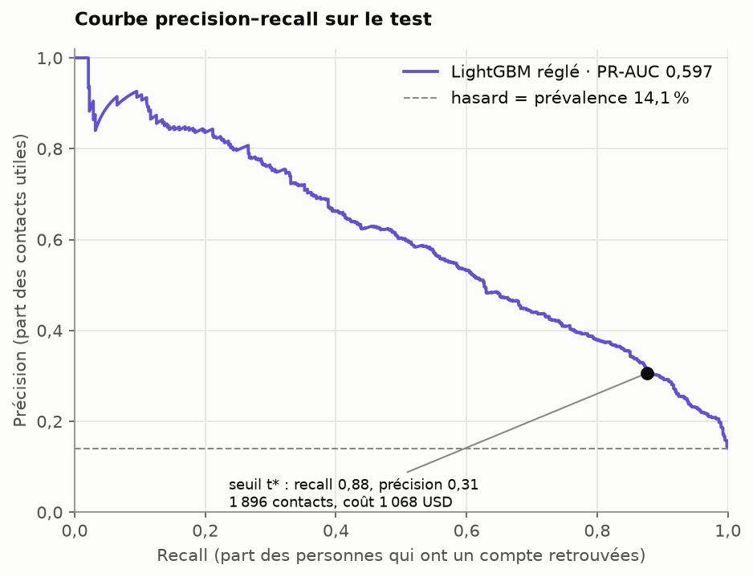
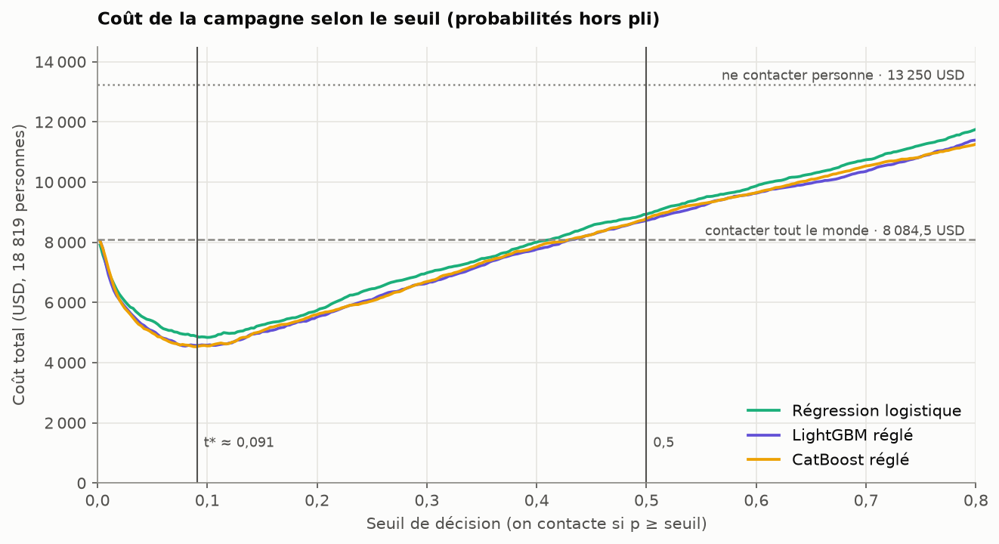
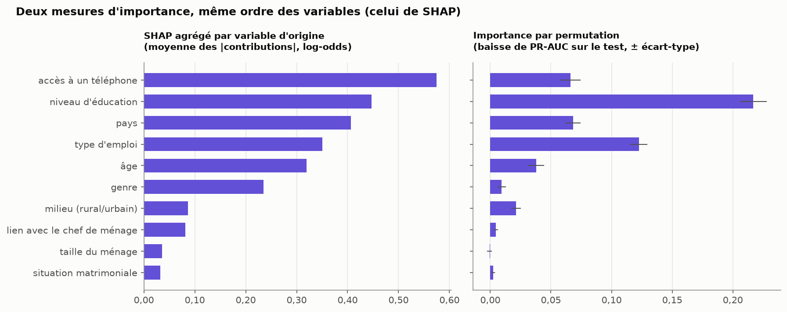
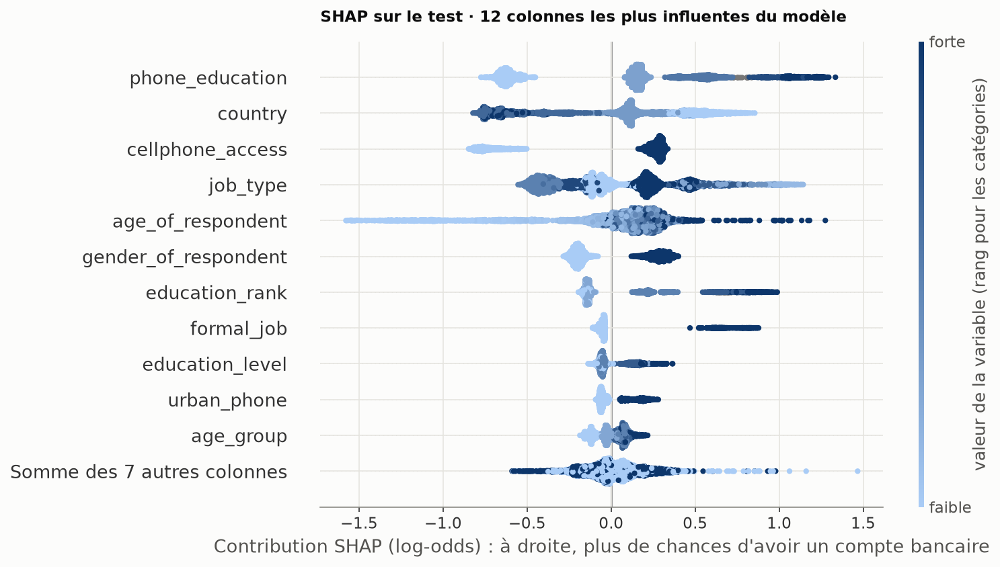
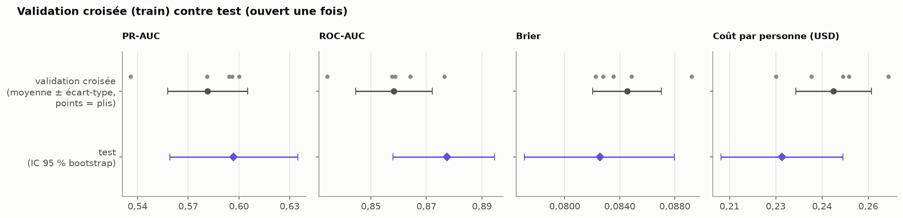

# Qui possède un compte bancaire ? Prédire l'inclusion financière en Afrique de l'Est

Cas pratique du **Module 5 · AIMS Sénégal** (Évaluation et optimisation des modèles de ML).

**En bref.** À partir de 23 524 personnes interrogées au Kenya, au Rwanda, en Tanzanie et en
Ouganda, on prédit qui a un compte bancaire (14 % des personnes). Le modèle final, un LightGBM
réglé par Optuna et utilisé au seuil fixé par les coûts, obtient sur le test, ouvert une seule
fois, une **PR-AUC de 0,597 [0,559 ; 0,635]** et coûte **0,227 USD par personne**, soit
**47 % de moins** que de contacter tout le monde.

## Le problème

Chaque ligne est une **personne interrogée** par les enquêtes FinScope (2016–2018) ; la cible
`bank_account` vaut 1 si elle **a un compte bancaire** (classe positive). Classification binaire
**déséquilibrée** : **14,08 %** des personnes ont un compte (3 312 sur 23 524).

Deux usages métier (hypothèses pédagogiques, fixées dans `config.py`) :

- **KaziPay** contacte les personnes qui ont un compte pour leur proposer un service de paiement
  mobile. Contacter une personne sans compte coûte **0,5 USD** (faux positif) ; oublier une
  personne qui a un compte fait perdre **5 USD** (faux négatif). On contacte si
  $p \cdot C_{FN} > (1-p) \cdot C_{FP}$, soit au-dessus du seuil
  $t^* = C_{FP}/(C_{FP}+C_{FN}) = 1/11 \approx 0{,}091$, **à condition que les probabilités soient
  calibrées**.
- La **banque centrale** estime le nombre de personnes qui ont un compte dans chaque pays en
  additionnant les probabilités prédites : elles doivent être **calibrées**.

| Rôle | Choix | Pourquoi |
|---|---|---|
| Métrique principale | **PR-AUC** | la classe positive est rare ; l'accuracy de « toujours Non » vaut déjà 86 % |
| Métriques secondaires | **coût total** au seuil retenu, **Brier** et **ECE** | l'objectif de KaziPay ; les besoins de la banque centrale |
| Rapportées aussi | ROC-AUC, log-loss, précision, recall, rapport de classification complet | |
| Plancher | `DummyClassifier` (« toujours Non ») | PR-AUC 0,141 = prévalence |
| **Modèle de base** | **régression logistique** | tout modèle plus complexe doit la battre de plus d'un écart-type |

## Données

Compétition **Financial Inclusion in Africa** ([Zindi](https://zindi.africa)), issue des enquêtes
**FinScope** 2016–2018 : 23 524 personnes, 4 pays (une année par pays), 10 variables
explicatives (pays, milieu, téléphone, genre, âge, taille du ménage, lien avec le chef de ménage,
situation matrimoniale, éducation, emploi). Les données **ne sont pas versionnées** : télécharger
le fichier d'entraînement de la compétition depuis Zindi et le placer dans `data/raw/` :

```
data/raw/inclusion-financiere-en-afrique.csv    # 23 524 lignes, 13 colonnes
data/raw/VariableDefinitions.csv
```

**Pièges trouvés à l'exploration** (notebook 01) et traités dans tout le projet :

- `uniqueid` est un identifiant **numéroté par pays** et `year` est **entièrement déterminée par le
  pays** : retirées des variables (`data.clean`, testé).
- **Doublons** : 7,4 % des lignes appartiennent à des profils identiques aux étiquettes
  contradictoires ; tout modèle commet au moins 2,2 % d'erreurs (bruit irréductible).
- **Modalités rares** : *Dont know* (situation matrimoniale, 8 lignes, toutes au Kenya),
  *Other/Dont know/RTA* (éducation, 35 lignes) : regroupées dans le pipeline (`min_frequency=20`).
- `job_type` est **codé différemment selon le pays** (pas de *Farming and Fishing* en Tanzanie ni
  en Ouganda) ; **1 799 personnes** sont déclarées *Spouse* mais *Single/Never Married* en Tanzanie.
- **Écart entre pays** : 25,1 % des personnes ont un compte au Kenya, 8,6 % en Ouganda ; **écart
  entre genres** : 10,7 % des femmes, 19,0 % des hommes.

## Installation

Le projet utilise **Python 3.14** et [uv](https://docs.astral.sh/uv/) (qui installe Python
automatiquement si besoin).

```bash
git clone https://github.com/kmache/financial-inclusion-africa.git
cd financial-inclusion-africa
uv sync                      # recrée exactement l'environnement à partir de uv.lock
# copier inclusion-financiere-en-afrique.csv et VariableDefinitions.csv dans data/raw/
```

## Reproduction

Exécuter les notebooks **dans l'ordre** (`uv run jupyter lab`, ou en ligne de commande avec
`uv run jupyter nbconvert --to notebook --execute --inplace notebooks/<notebook>.ipynb`). Chacun
s'exécute de haut en bas, régénère ses figures dans `reports/figures/` et contient la réponse
rédigée à chaque question du guide.

| Notebook | Étapes | Contenu | Durée (12 cœurs) |
|---|---|---|---|
| `01_exploration` | 1–2 | cadrage, seuil $t^*$, exploration (Q1.x, Q2.x) | ≈ 20 s |
| `02_preparation_protocole` | 3–4 | variables, pipeline, test sous scellé, CV stratifiée et par pays | ≈ 20 s |
| `03_baselines_ensembles` | 5–6 | biais–variance, forêts, boostings | ≈ 2 min |
| `04_hyperparametres` | 7 | Random Search, Optuna, Halving, nested CV | ≈ 12,5 min |
| `05_calibration_seuil` | 8–9 | calibration, seuil selon les coûts, choix du modèle final | ≈ 6 min |
| `06_test_final_interpretation` | 10–11 | test final (une seule fois), permutation, SHAP, audit par genre | ≈ 40 s |

```bash
uv run pytest                          # 55 tests (ceux qui lisent les données sont ignorés si data/raw/ est vide)
uv run ruff check src tests            # style
```

Les résultats sont reproductibles : `random_state = 42` partout, CatBoost sur un nombre de threads
fixé (`models.CATBOOST_THREADS`), Optuna avec un échantillonneur à graine. **Vérifié** sur un clone
neuf du dépôt (`uv sync`, données copiées, six notebooks exécutés, ≈ 22 min au total) : tous les
scores sont identiques à ceux des notebooks versionnés ; seuls les temps de calcul changent.

## Méthode

```python
from financial_inclusion_africa import models
from financial_inclusion_africa.data import load_split
from financial_inclusion_africa.evaluate import CV, evaluate_cv

X_train, X_test, y_train, y_test = load_split()              # 80 / 20 stratifié, graine 42
row, res = evaluate_cv(models.make_final(), X_train, y_train)   # même objet CV pour tous les modèles
final = models.make_final().fit(X_train, y_train)               # puis, une seule fois, le test
contact = final.predict_proba(X_test)[:, 1] >= models.FINAL_THRESHOLD
```

1. **Pipeline sans fuite** (`features.pipe`) : `AddFeatures` (sans apprentissage) ajoute les
   variables du guide (`education_rank`, `is_head`, `formal_job`, `urban_phone`, `age_group`), un
   indicateur `education_unknown` et deux variables à nous (`phone_education`, `lives_alone`) ;
   tout ce qui apprend des données (encodage, imputation, standardisation) est dans le pipeline et
   ajusté dans chaque pli. Encodage selon la famille de modèle : one-hot + standardisation
   (régression logistique), ordinal (forêts), **catégories natives** (boostings).
2. **Protocole** : test (4 705 personnes) mis sous scellé dès le départ ; un seul objet `CV`
   (`StratifiedKFold`, 5 plis, graine 42) pour tous les modèles ; chaque score avec son
   écart-type ; comparaisons **pli par pli** (différences appariées) ; règle d'une erreur-type pour
   départager à performance égale. Contrôle supplémentaire : validation croisée **par pays**.
3. **Modèles comparés** : plancher, régression logistique, forêts aléatoires (diagnostic
   biais–variance par courbes d'apprentissage et de validation), HistGradientBoosting, XGBoost,
   LightGBM, CatBoost, en one-hot et en catégories natives.
4. **Réglage** des deux meilleurs candidats (LightGBM, CatBoost) : Random Search et Optuna
   (40 essais), HalvingRandomSearchCV, estimation honnête par **nested CV**.
5. **Calibration** mesurée sur prédictions hors pli (diagramme de fiabilité, ECE avec son plancher
   de bruit, Brier, comptes par pays), avant et après Platt et isotone.
6. **Seuil** : $t^*$ comparé au seuil 0,5, au seuil appris (`TunedThresholdClassifierCV`, évalué en
   CV emboîtée) et aux stratégies sans modèle.
7. **Test** ouvert une seule fois, intervalles de confiance par **bootstrap** ; puis
   **interprétation** (permutation, SHAP agrégé par variable d'origine, audit par genre).

**Écarts assumés au guide** : pas de couche de calibration sur le modèle final (il est déjà
calibré, voir Résultats) ; une éducation inconnue donne `NaN` + un indicateur, pas `-1`.

## Résultats

### Validation croisée (train, 5 plis, moyenne ± écart-type)

| Modèle | PR-AUC | Brier | Coût / personne au seuil $t^*$ |
|---|---|---|---|
| Plancher (`DummyClassifier`) | 0,141 | 0,121 | 0,430 USD |
| **Régression logistique (modèle de base)** | **0,561 ± 0,026** | 0,087 | 0,259 ± 0,006 USD |
| Forêt aléatoire, par défaut | 0,475 ± 0,034 | 0,103 | — |
| Forêt aléatoire, `min_samples_leaf=10` | 0,573 ± 0,031 | 0,086 | — |
| XGBoost, par défaut | 0,540 ± 0,025 | 0,090 | — |
| HistGradientBoosting, natif | 0,574 ± 0,026 | 0,085 | — |
| LightGBM, par défaut | 0,564 ± 0,023 | 0,086 | — |
| CatBoost natif, par défaut | 0,583 ± 0,027 | 0,084 | — |
| **LightGBM réglé (Optuna) · modèle final** | **0,581 ± 0,024** | 0,085 | **0,244 ± 0,012 USD** |
| CatBoost réglé (Optuna) | 0,584 ± 0,027 | 0,084 | 0,241 ± 0,011 USD |

- Les ensembles battent la régression logistique **dans les 5 plis**, mais de moins d'un
  écart-type : le bruit irréductible plafonne tous les modèles.
- Le réglage corrige le **surapprentissage** de LightGBM (PR-AUC d'entraînement 0,71 → 0,62) ;
  estimation honnête de la procédure de réglage (nested CV) : 0,579 ± 0,025.
- **Calibration** : les trois candidats sont déjà calibrés (ECE 0,005, dans le plancher de bruit) ;
  Platt dégrade CatBoost ; la forêt par défaut a besoin d'une calibration isotone (ECE 0,058 → 0,007).
- **Choix final** : CatBoost coûte 0,003 USD de moins par personne (5 plis sur 5), mais l'écart est
  sous l'erreur-type des coûts : la règle d'une erreur-type retient LightGBM, plus simple et plus de
  10 fois plus rapide. Seuil : $t^*$, car le seuil appris (0,08–0,11) ne fait pas mieux.

### Test (4 705 personnes, ouvert une seule fois)

| Métrique | Test | IC 95 % (bootstrap, 1 000 tirages) | Validation croisée |
|---|---|---|---|
| **PR-AUC** | **0,597** | [0,559 ; 0,635] | 0,581 ± 0,024 |
| ROC-AUC | 0,876 | [0,861 ; 0,889] | 0,861 ± 0,010 |
| Brier | 0,083 | [0,077 ; 0,088] | 0,085 ± 0,003 |
| ECE | 0,015 | [0,011 ; 0,025] | 0,005 |
| Précision / recall au seuil $t^*$ | 0,306 / 0,876 | [0,286 ; 0,326] / [0,851 ; 0,902] | 0,301 / 0,852 |
| **Coût par personne** | **0,227 USD** | [0,207 ; 0,247] | 0,244 ± 0,012 |

**Coût au seuil retenu**, sur le test :

| Stratégie | Contactés | Personnes oubliées | Coût |
|---|---|---|---|
| Ne contacter personne | 0 | 662 | 3 310 USD |
| Contacter tout le monde | 4 705 | 0 | 2 021,5 USD |
| **Modèle final au seuil $t^*$** | **1 896** | **82** | **1 068 USD (−47 %)** |

Le seuil compte autant que le modèle : au seuil 0,5, le même modèle oublierait 64 % des personnes
qui ont un compte et coûterait plus cher que de contacter tout le monde (hors pli sur le train :
8 724 contre 8 084,5 USD). Les estimations de validation croisée tombent dans les intervalles du
test (la ROC-AUC à la limite) : le protocole a tenu. Le test n'a servi qu'une fois ; aucune décision n'a été modifiée
après l'avoir vu, et les autres candidats n'y ont pas été évalués.

### Ce que le modèle a appris

| Variable | Permutation (baisse de PR-AUC, test) | SHAP agrégé (log-odds) |
|---|---|---|
| Niveau d'éducation | **0,217** (1er) | 0,447 (2e) |
| Type d'emploi | 0,123 (2e) | 0,350 (4e) |
| Pays | 0,068 (3e) | 0,407 (3e) |
| Accès à un téléphone | 0,066 (4e) | **0,575** (1er) |
| Âge | 0,038 (5e) | 0,319 (5e) |
| Genre | 0,009 (7e) | 0,235 (6e) |

- Les trois hypothèses de l'exploration sont confirmées : **éducation, revenu formel, téléphone**.
- Les valeurs SHAP sont agrégées par **variable d'origine** (somme signée des colonnes construites) :
  sans cela, l'éducation, répartie sur quatre colonnes, paraît secondaire.
- **Genre** : au seuil $t^*$, le modèle retrouve **83 % des femmes** qui ont un compte contre
  **92 % des hommes** (test). Sans la variable (validation croisée) : même coût, PR-AUC −0,004,
  écart de recall **divisé par deux**.

## Figures

Toutes les figures sont dans [`reports/figures/`](reports/figures/) (préfixe = numéro d'étape).

| Diagrammes de fiabilité (hors pli) | Courbe precision–recall (test) |
|---|---|
|  |  |

| Coût selon le seuil | SHAP et permutation |
|---|---|
|  |  |





## Limites

- **Généraliser à un autre pays** : quand un pays est absent de l'entraînement (validation
  croisée par pays), la PR-AUC tombe à **0,487 ± 0,086** et les probabilités sont fausses (Ouganda :
  19,1 % prédits pour 8,9 % réels). Un déploiement au Sénégal exigerait des données locales et une
  recalibration. Les enquêtes datent de 2016–2018, une année par pays : l'essor du mobile money
  depuis a pu changer les relations apprises.
- **Variables sensibles** : le genre fait baisser la probabilité des femmes et creuse l'écart de
  recall. **Recommandation : l'exclure du ciblage et le garder pour l'audit** (recall et part
  contactée par genre suivis à chaque version). Ses proxys restent : les autres variables devinent
  le genre avec une ROC-AUC de 0,91 (*Spouse* : 99 % de femmes). Cette recommandation est évaluée
  par validation croisée seulement : les chiffres du test sont ceux du modèle avec le genre.
- **Coûts hypothétiques** : 0,5 et 5 USD sont des hypothèses pédagogiques ; le seuil doit suivre
  les vrais coûts (avec $C_{FN} = 2$ USD, $t^* = 0{,}2$ et deux fois moins de contacts). Des
  probabilités calibrées permettent de changer de seuil sans réentraîner.
- **Corrélation et causalité** : le modèle prédit, il n'explique pas le monde. « Donner un téléphone
  fait ouvrir un compte » ne se déduit ni du modèle ni de SHAP (facteurs de confusion, causalité
  inverse, revenu non mesuré) ; il faudrait une expérience.
- **Qualité des données** : `job_type` codé différemment selon le pays (son importance mêle emploi
  et pays), incohérence *Spouse* / *Single* en Tanzanie, 7,4 % de profils contradictoires.
- **Incertitude** : sur 4 705 personnes, la PR-AUC du test est connue à ± 0,04 près ; les écarts
  entre les meilleurs candidats (0,003) sont indiscernables à cette échelle. Sur le test, le modèle
  surestime légèrement le total (680 prédits pour 662, +2,7 %, dans le bruit attendu).

## Structure

```
financial-inclusion-africa/
├── data/raw/                      # données brutes (non versionnées)
├── data/processed/                # fichiers intermédiaires (non versionnés)
├── notebooks/                     # 01 → 06, exécutables de haut en bas
├── src/financial_inclusion_africa/
│   ├── config.py                  # chemins, graine, coûts métier
│   ├── data.py                    # chargement, séparation X / y, test sous scellé (load_split)
│   ├── eda.py                     # exploration : taux par modalité, V de Cramér, doublons, modalités rares
│   ├── features.py                # AddFeatures, préprocesseurs, pipe(model, features, encoding)
│   ├── models.py                  # hyperparamètres réglés, candidats, modèle et seuil finaux (make_final)
│   ├── evaluate.py                # métriques, coût, seuil t*, protocole de CV, calibration, bootstrap
│   └── viz.py                     # style et graphiques (palettes validées daltonisme, fiabilité)
├── reports/figures/               # figures exportées par les notebooks
└── tests/                         # 55 tests (pytest)
```

## Règles suivies

`random_state = 42` partout · le test reste scellé jusqu'à l'étape 10 et ne sert qu'une fois ·
même objet `cv` pour tous les modèles · toujours la moyenne ± l'écart-type · toutes les
transformations qui apprennent sont dans le pipeline · une étape, un commit.
